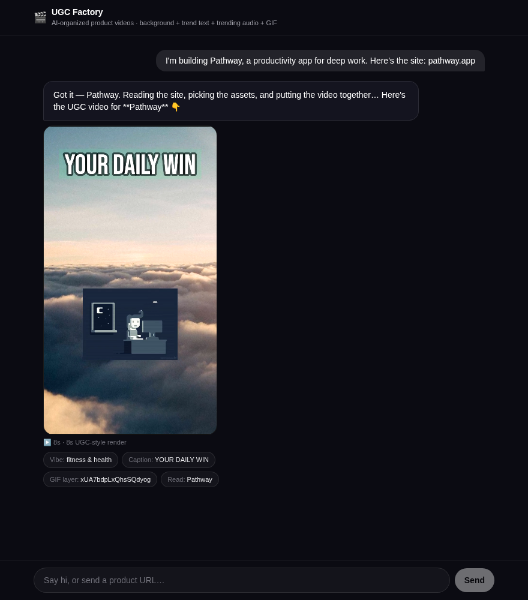

# UGC Factory

**Send a product. Get a ready-to-post UGC-style video back.**

UGC Factory is a chat interface that turns a product pitch into a vertical marketing
video. Paste a product URL (or describe what you're building) and it reads the site,
picks the creative direction, and renders an 8-second 9:16 MP4 — background, hook
caption, motion, GIF layer and audio bed — in a few seconds.

No prompt engineering, no timeline, no export settings. One message in, one video out.



---

## What it is

Short-form product video is the highest-volume creative format in paid social and the
slowest to produce. UGC Factory collapses the loop: describe the product, get a
publishable draft you can test immediately.

The design position is deliberate: **AI-organized, not AI-generated.**

- No diffusion model, no video generator, no GPU.
- Every frame is assembled deterministically from real assets with ffmpeg.
- The model's job is judgement — what is this product, what is the hook, which vibe —
  not pixel synthesis.

That trade buys speed (seconds, not minutes), cost (zero inference spend), and control
(every asset is swappable, and the output never has the uncanny look of generated
video). It is also the difference between a demo and something you would actually put
ad budget behind.

## How it works

```
   user message
        │
        ▼
   ┌──────────────┐   LLM, JSON contract          ┌────────────────────────┐
   │  /api/chat   │──────────────────────────────▶│ kind: chat | video     │
   │              │                               │ product + hook + vibe  │
   └──────┬───────┘◀─── offline rule engine ──────└────────────────────────┘
          │            (no API key required)
          ▼
   asset pack builder
   vibe detection → background seed, caption, font size, accent colour,
                    GIF, audio bed
          │
          ▼
   /api/video?k=<base64url asset pack>
          │
          ▼
   ffmpeg filter graph
   scale + crop → zoompan (slow push-in) → GIF overlay → drawtext caption
   → audio trim/pad → H.264 + AAC, faststart
          │
          ▼
   cached MP4 (memory + disk, keyed by the asset pack)
```

**Intent handling.** The model receives the thread plus a strict contract and returns
either a chat reply or a video request with structured product fields. If it returns
prose instead of JSON (common with small free models), the prose is used as the reply
and the deterministic rule engine still handles a product URL in the message.

**Rendering.** The asset pack is serialised into the video URL, so `/api/video` is
stateless: the same URL always produces the same file, and the render is cached in
memory and on disk. There is no job queue and no database.

## Design decisions

**Chat as the interface.** No form with fourteen fields. People describe products
conversationally, and the assistant can ask a follow-up when a detail is missing.

**Deterministic render over generative video.** An ffmpeg filter graph is auditable,
reproducible, fast and free. It also means the caption text is real text — legible,
exact, and not hallucinated glyphs.

**Graceful degradation by default.** With no API key configured, the app still works
end to end: regex intent detection, domain-based product extraction, hashed asset
selection. The LLM improves conversation quality; it is never a dependency for
producing a video.

**Asset scarcity as a feature.** Backgrounds, GIFs and audio come from keyless public
sources and are selected by hash of the product name, so output is stable per product.
Swapping in a licensed brand library is a change of constants, not architecture.

## Stack

| Layer | Choice |
|---|---|
| App | Next.js 15 (App Router), React 19, TypeScript |
| Styling | Tailwind CSS |
| Video | ffmpeg (`ffmpeg-static` locally, system ffmpeg in Docker) |
| Chat model | Any OpenAI-compatible endpoint — OpenRouter, Groq or OpenAI (optional) |
| Shipping | Docker, single service, `render.yaml` included |

## Run it locally

```bash
npm install
npm run dev
# http://localhost:3000
```

That is the whole setup. Without an API key the app runs on the offline rule engine.

To enable free-form chat, copy `.env.example` to `.env.local` and add one key:

```bash
OPENROUTER_API_KEY=sk-or-v1-...      # free open-weights models
# or
GROQ_API_KEY=gsk_...                 # llama-3.3-70b-versatile
# or
OPENAI_API_KEY=sk-...
```

| Variable | Required | Purpose |
|---|---|---|
| `OPENROUTER_API_KEY` / `GROQ_API_KEY` / `OPENAI_API_KEY` | No | Enables LLM chat and product understanding |
| `OPENROUTER_BASE_URL` | No | Custom OpenAI-compatible base URL |
| `LLM_MODEL` | No | Override the default model per provider |
| `FFMPEG_PATH` | No | Explicit ffmpeg binary if `ffmpeg-static` is unusable |

Other scripts:

```bash
npm run build       # production build
npm run typecheck   # tsc --noEmit
```

## API

| Endpoint | Method | Description |
|---|---|---|
| `/api/chat` | POST | `{ messages: [{ role, content }] }` → text reply or a video payload with `videoUrl`, product and asset pack |
| `/api/video` | GET | `?k=<asset pack>&v=<seconds 5–10>` → `video/mp4`, immutable and cacheable |
| `/api/health` | GET | Provider detection and configuration flags; never returns key values |

## Deploy

```bash
docker build -t ugc-factory .
docker run -p 3000:3000 ugc-factory
```

The image installs system ffmpeg so rendering does not depend on npm binary packaging.
`render.yaml` deploys the same Dockerfile as a single web service with a health check.

## Project layout

```
app/
  page.tsx            chat UI, video card, asset chips
  api/chat/route.ts   intent + product extraction → asset pack → video URL
  api/video/route.ts  stateless render endpoint
  api/health/route.ts provider diagnostics
lib/
  brain.ts            intent classification, product parsing, fallback rules
  llm.ts              provider-agnostic chat client with JSON contract + retry
  vibe.ts             taste/taxonomy mapping: keywords → vibe, colour, type size
  assets.ts           asset pack builder (background, GIF, audio, caption)
  render.ts           ffmpeg filter graph, caching, timeouts
  types.ts            shared contracts
public/fonts/         bundled display font, so renders are reproducible
```

## Status and limitations

Working MVP. The happy path — product URL in, publishable 8-second video out — is
solid, cached, and deployable as one container.

Honest gaps, in rough priority order:

- **Assets are placeholder stock.** Backgrounds (Picsum), GIFs (Giphy) and audio are
  public and unlicensed for commercial use. A production instance needs a licensed
  library, and per-brand asset packs.
- **Asset health is not validated.** A source can return an error image with HTTP 200,
  and it would be composited straight into the video. A pre-render check on content
  type, dimensions and byte size is needed before this faces a client.
- **One format.** 8 seconds, 720×1280. Longer cuts, 1:1 and 16:9 need additional
  filter graphs.
- **No voiceover.** The audio bed is music only; TTS narration is the obvious next
  layer and would change the pacing model.
- **Caption is a single overlay**, not word-timed subtitles. Timing requires forced
  alignment against the audio.
- **No persistence.** No accounts, no history, no render records; the cache is
  instance-local and unreachable by a second replica.
- **No abuse protection.** Render endpoints are unbounded; production needs rate limits
  and per-IP quotas, since a render costs CPU.
- **English-only type handling.** The bundled display font has no fallback chain.

## Roadmap

1. Licensed asset library plus per-brand packs (the single biggest quality lift).
2. Multiple durations and aspect ratios from the same asset pack.
3. Word-timed captions from forced alignment.
4. TTS voiceover with script templates per vibe.
5. Render queue with a durable store, so replicas share cache and jobs survive restarts.
